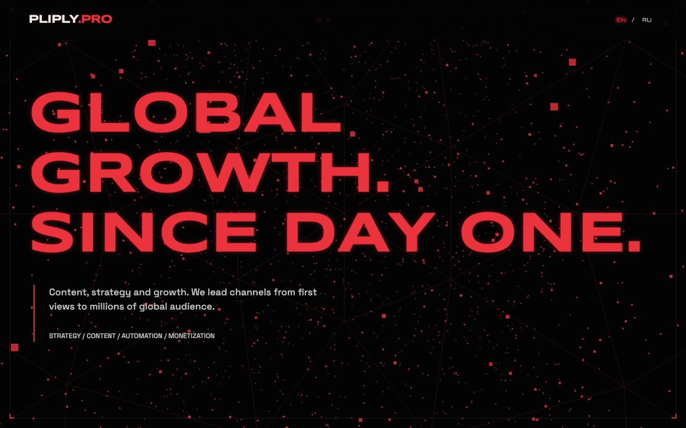
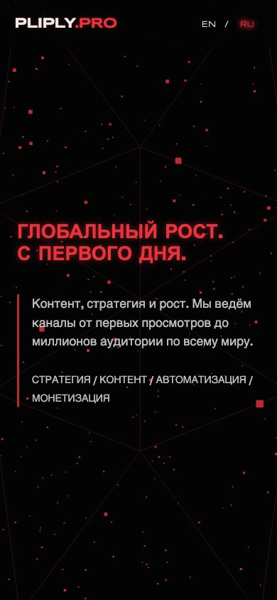
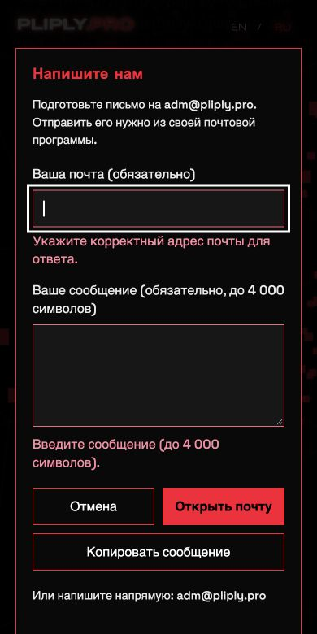
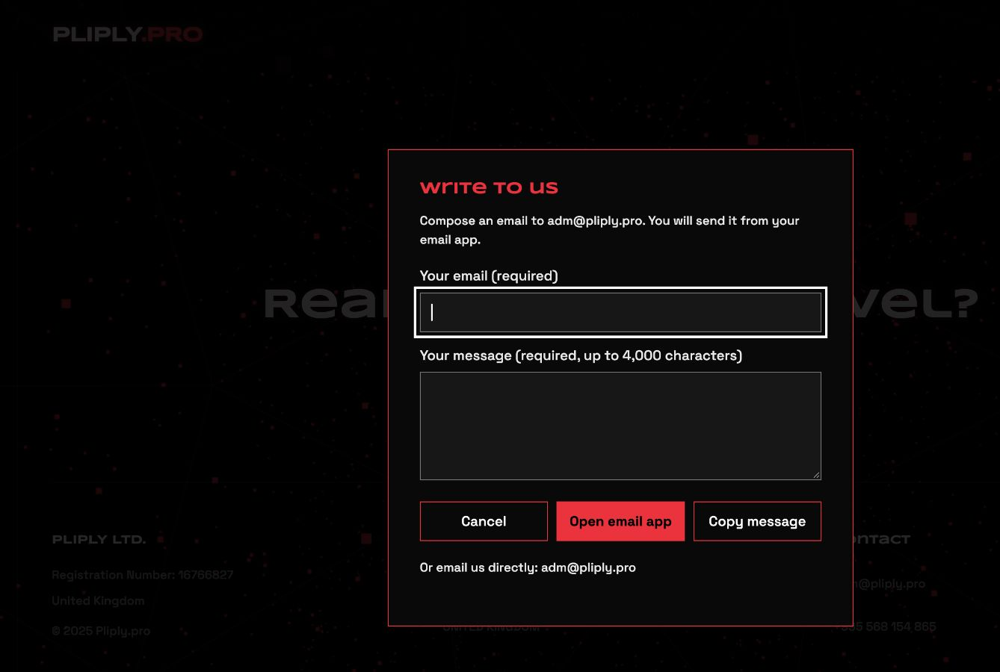

# Проверка первого этапа — 21 октября 2026

**Результат:** код подготовлен для review без публикации. Главная работает на
320/390/768/1440 px в EN/RU; диалог и язык не зависят от декорации. Веб-обработчик
формы не подключён, почтовая доставка не проверена. HTTPS production по-прежнему
требует отдельного включения Enforce HTTPS. Юрданные требуют владельца.

## Основание и актуальность

- Прочитаны `audit-report.html`, `upgrade-plan.csv`, issues/checks и доказательства
  из локальной папки `pliply-audit-2026-10-21`.
- Чистая новая копия репозитория, ветка `codex/pliply-stage-one` от main
  `3c7610571a076bed908ec05f1f65c159c38aa530`; удалённая main перепроверена.
- Все 13 опубликованных HTML и `/` повторно получены GET: байты совпадают с
  аудитом. Настройки Pages и HTTP перепроверены, значения прежние. Замечания
  аудита относятся к текущему коду, а не устаревшей версии.
- `AGENTS.md` в дереве репозитория и родительских папках проекта отсутствует;
  исходный README.txt прочитан. Специальных команд сборки/тестов не было.
- Найдено дополнительно 13 публичных вариантов без расширения (включая index)
  и 3 удалённых исторических страницы. См. URL-карту и HTTP evidence.

## Сценарии и результаты

Проверка в Codex In-app Browser, размеры задавались viewport-эмуляцией, без
настоящего телефона. Код сайта и полные загрузки проверены локально на 127.0.0.1:8879.

| Проверка | Результат | Доказательство |
|---|---|---|
| Главная, 4 ширины × EN/RU | 8/8: scrollWidth равен innerWidth, заголовки/услуги/CTA/контакты внутри экрана | responsive.json |
| Все 12 старых страниц, 4 ширины | 48/48 после load: нет горизонтального overflow, неработающих img; есть H1 | legacy-responsive.json |
| Язык | EN исходного HTML; RU сохраняется после reload; кнопки доступны клавиатуре и имеют aria-pressed | storage-denied.json, responsive.json; ручной RU reload |
| localStorage read/write throws | Сайт стартует EN, переключается RU в памяти, reload безопасно возвращает EN | storage-denied.json |
| Открыть форму | Фокус email, фон inert средствами dialog, прокрутка body заблокирована | modal-keyboard.json |
| Shift+Tab от первого поля | Фокус последней ссылке внутри окна | modal-keyboard.json |
| Tab от последней ссылки | Фокус первому полю, под окно не уходит | modal-keyboard.json |
| Escape / Cancel | Закрытие, фокус исходному CTA, overflow body восстановлен; текст остаётся | modal-closed-settled.json, form-repeat.json |
| Ошибки EN/RU | Пустые/пробельные значения и неверный email отмечены aria-invalid, ошибки связаны aria-describedby; фокус первому неверному полю | modal-keyboard.json, phone-modal-errors-390.jpg |
| Малая высота 320×500 | Окно целиком внутри viewport; содержимое прокручивается, Cancel доступен в EN/RU | short-modal.json |
| Отказы Three.js / GSAP / всех CDN / WebGL | Сцена отключена, RU/форма/почта работают | faults-browser.json |
| Reduced motion | Модель matchMedia + CSS: сцена не загружается, animation:none, интерфейс работает | faults-browser.json |
| Без любого JS | Исходный EN-контент и контактные mailto доступны; интерактивный RU без JS не обещается | no-js.json |
| Formspree-adapter, локальный mock | accepted / 429 / 422 / 503 / HTML вместо JSON / timeout дают разные корректные состояния, текст и окно остаются | form-browser.json |
| Повтор во время запроса | Кнопка disabled, поля readOnly; Enter не создаёт дубль | form-repeat.json, mock-request-counts.json |
| Повтор после принятия | Закрытие/открытие сохраняет блокировку; редактирование разрешает новое обращение | form-repeat.json |
| Транспорт без сети | 5 содержательных Node-тестов пройдены: URL, JSON-протокол, ошибки, timeout без автоповтора, кодирование mailto | test-results.txt |
| Консоль главной | warn/error: пусто | main-console.json |
| Консоль старых страниц | Проверена отдельно после удаления ненужного app.js, warn/error: пусто | legacy-console.json |
| Статика / синтаксис / whitespace | Проверки локальных ссылок/изображений, JS syntax, git diff --check | static-check.json, test-results.txt |

`modal-keyboard.json.closed` — момент сразу после `dialog.close()`: событие close
обрабатывается следующей задачей. `modal-closed-settled.json` фиксирует уже
восстановленный overflow `""`. Это не оставшаяся блокировка прокрутки.
У mock accepted в счётчике 2 запроса: первый сценарий приёма + отдельный сценарий
повтора (два Enter/submit действия дали один дополнительный запрос).

Для проверки отказов используются отдельные маршруты локального preview,
меняющие только соответствующую границу: URL зависимостей, выброс WebGL,
запрет localStorage, matchMedia либо локальное назначение POST. Тела сообщений
синтетические. Это не сбои production и не проверка реальной доставки.
Первые замеры старых страниц до готовности CSS отброшены; итоговые сняты после load.

## Скриншоты

Основные кадры имеют точные размеры 1440×900 и 390×844. Нативный снимок
диалога на компьютере имеет 1338×900 (особенность захвата IAB при viewport 1440);
снимок мобильного диалога — 390×780. Это визуальное доказательство состояния,
точные размеры layout фиксируются отдельно в JSON.

Полная мобильная страница: `phone-ru-390-full.jpg`.

## Что остаётся открытым

- [Решения владельца](owner-decisions.md): UK/Georgia, адреса, телефон, цифры,
  права на материалы, окончательное закрытие/перенос каждого старого URL.
  Старая контактная страница пока содержит прежние юрданные, главный сайт — UK.
  Старые страницы остаются только EN; новая локализация их содержания зависит
  от решения о сохранении. Главная и форма полностью EN/RU.
- Formspree: аккаунт, form-ID, выбранная квота, серверный антиспам, рабочий CORS,
  уведомление об обработке данных и приёмочный тест с подтверждением письма.
  До этого используется честный email/copy fallback. Никаких писем сейчас.
- [Enforce HTTPS](https.md) и повторная проверка HTTP-цепочек после отдельной
  публикации. Ветка не меняет текущие настройки Pages/DNS/почты.
- Физические iOS/Android, экранная клавиатура, screen reader и Safari/Firefox
  для нового кода в этой сессии не проверялись. Высота 500 px лишь моделирует
  уменьшенный экран. Reduced motion моделировался на стенде; системная настройка
  компьютера не менялась.
- Новый Lighthouse/CrUX, FPS и батарея не измерялись; прежние 87/98 из аудита
  не выдаются за результат этого кода. Тяжёлые favicon/OG и оформление кейсов
  остаются следующими этапами. Полное соответствие WCAG не заявляется.
- Фактический Pages/Jekyll build `_config.yml` проверить после разрешённого
  релиза; локальная проверка не заменяет серверную сборку GitHub Pages.

Не выполнялись merge, deployment, изменение Enforce HTTPS, DNS, почты,
покупка/регистрация форм-сервиса или реальная отправка. Применён workflow
`vercel:verification` для проверки
границ UI → локальный mock → ответ; приложение остаётся на GitHub Pages.
